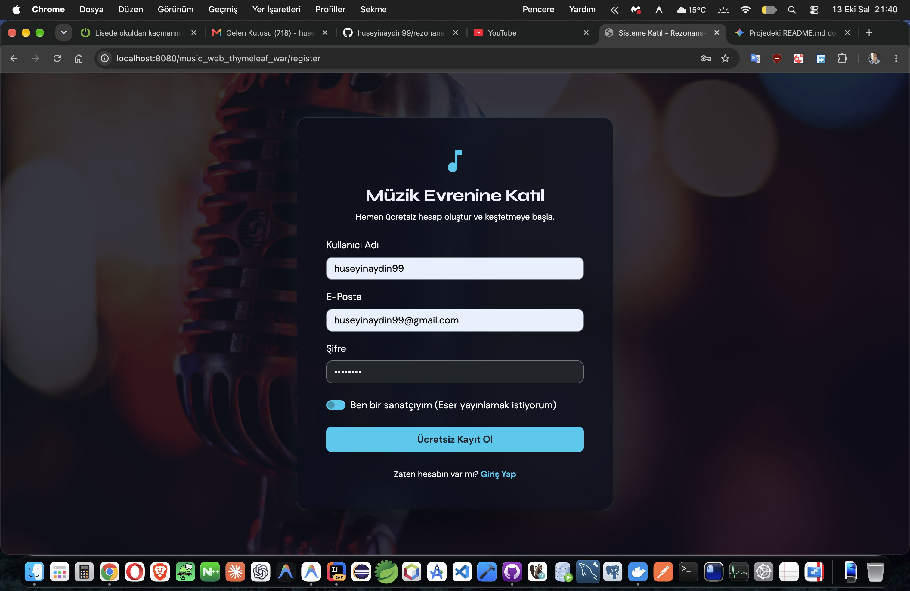
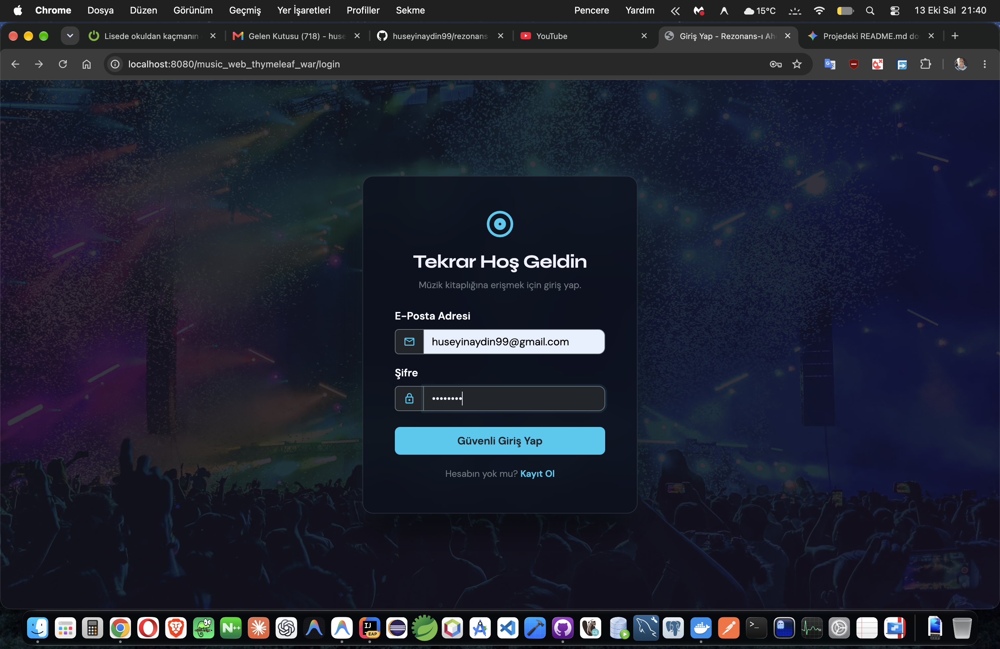
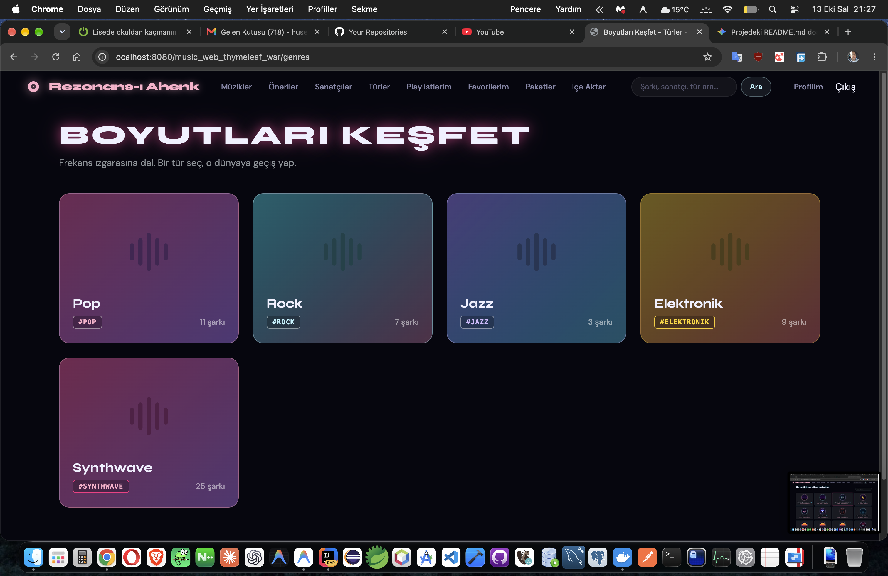
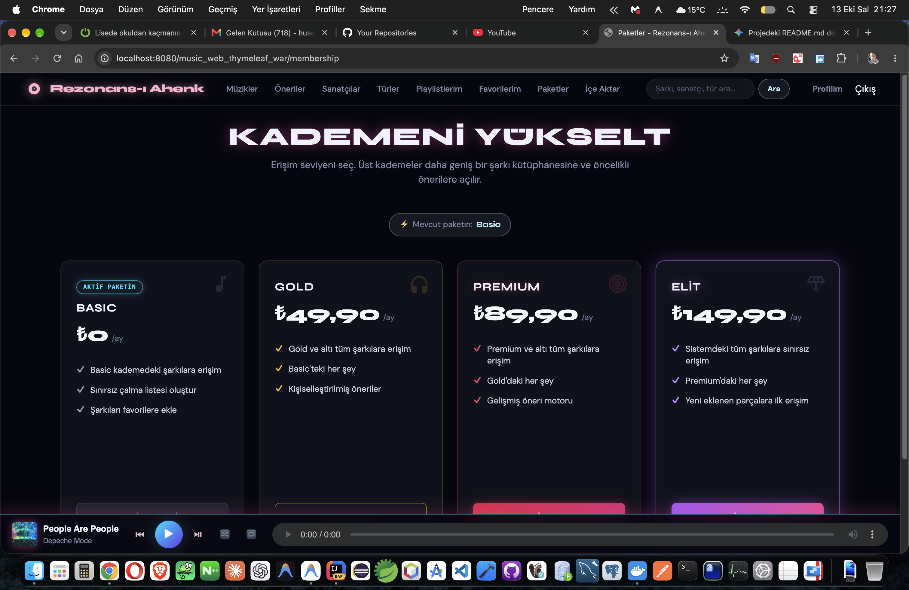
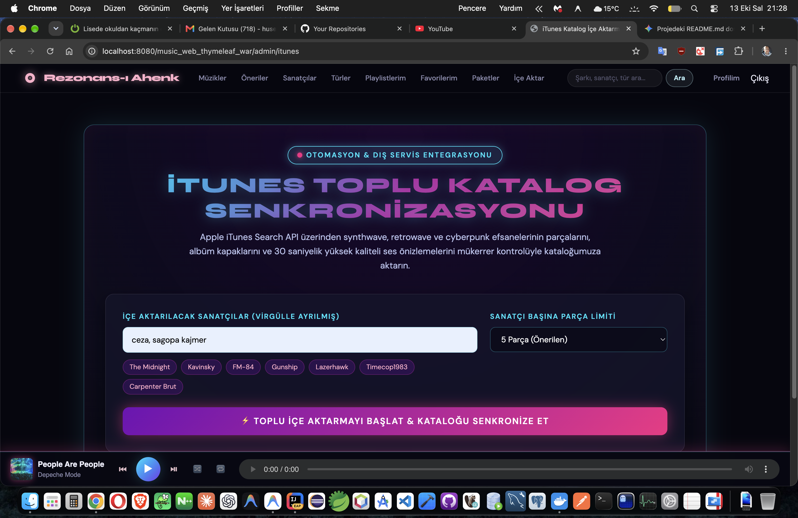
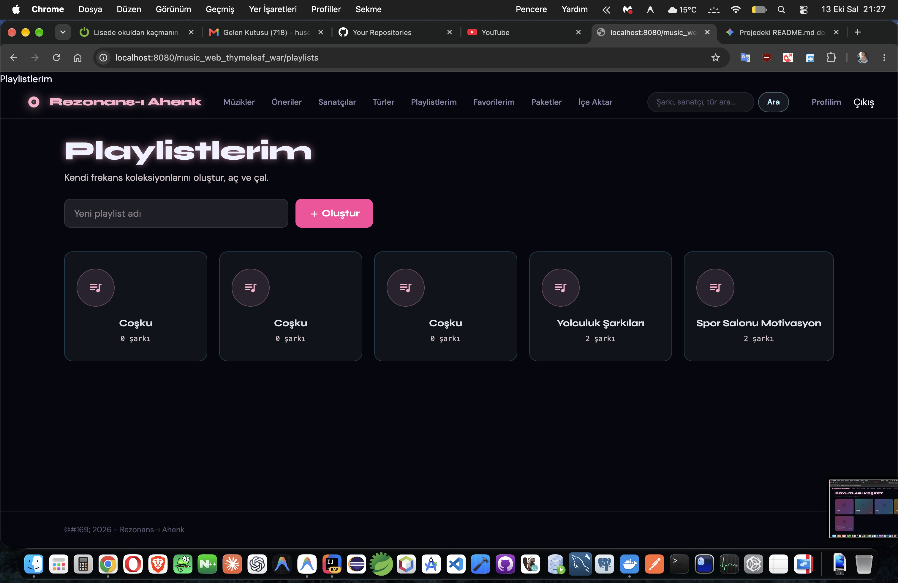
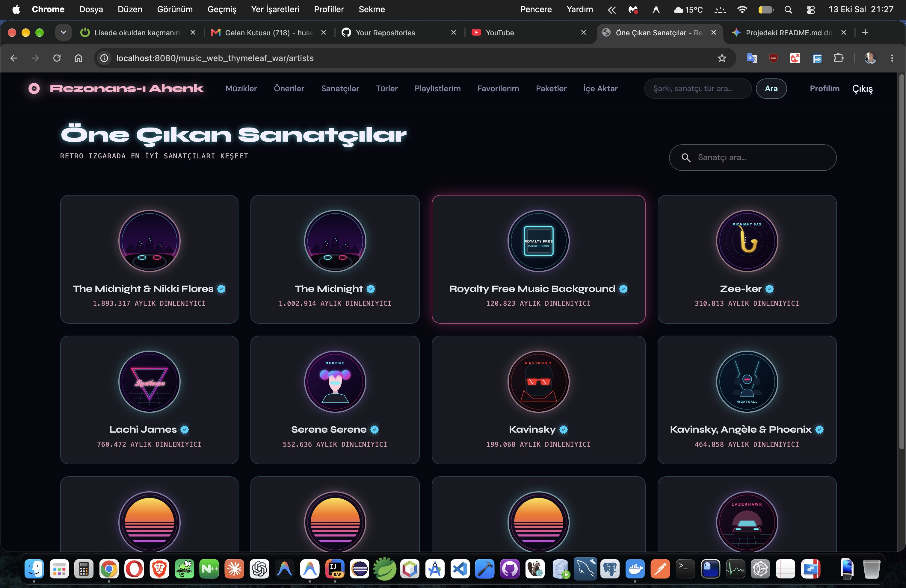
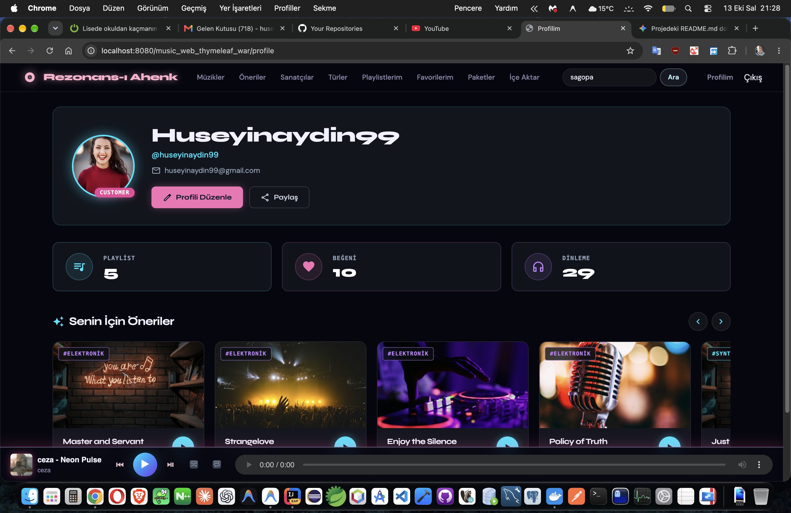
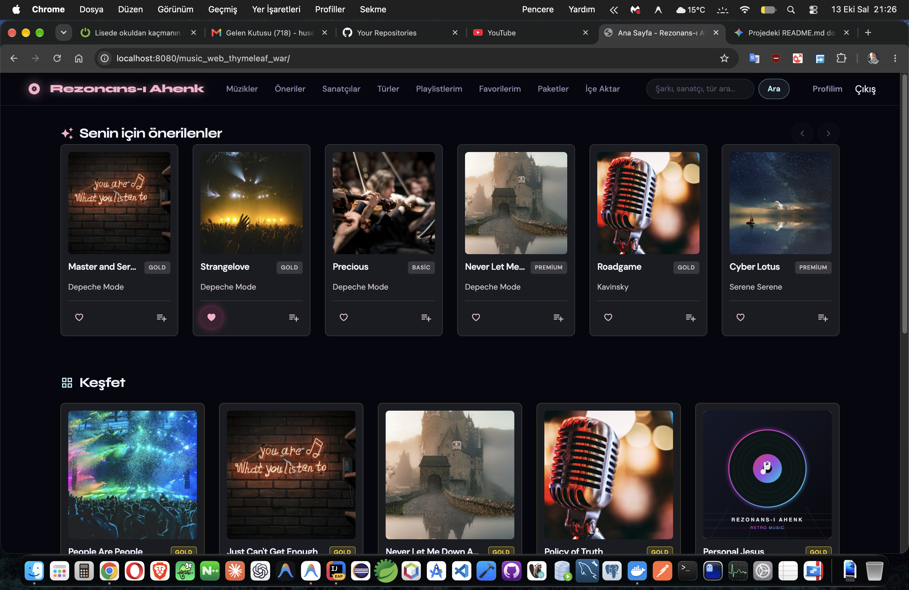

# 🎼 Rezonans-ı Ahenk

> *"Nağme, kalpten kalbe uzanan en kısa yoldur; mimari ise o yolun çökmemesini sağlayan temeldir."*

Bu satırları okuyan meslektaşım, karşında duran eser; bir müzik dinleme platformundan ibaret görünse de, aslında **düzenin, sınırların ve sürdürülebilirliğin** koda dökülmüş hâlidir. Rezonans-ı Ahenk'i kurarken yalnızca çalışan bir uygulama değil, aradan yıllar geçse dahi bakımı kolay, büyümeye müsait ve iş kuralları kendi sarayında emniyette kalan bir yapı arzu ettim. Aşağıda; neyi, niçin ve nasıl yaptığımı, hiçbir kararı gizlemeden ve hiçbir tercihi savsaklamadan anlatıyorum.

---

## Tanıtım Görselleridir;














## 📑 İçindekiler

1. [Projenin Mahiyeti ve Gayesi](#-projenin-mahiyeti-ve-gayesi)
2. [Çözüm Getirdiği Somut Sorunlar](#-çözüm-getirdiği-somut-sorunlar)
3. [Teknoloji Haritası (Özet Tablo)](#-teknoloji-haritası)
4. [Mimari Yaklaşım ve Gerekçeleri](#-mimari-yaklaşım-ve-gerekçeleri)
5. [Tasarım Şablonları (Design Patterns)](#-tasarım-şablonları)
6. [Algoritmalar ve Akıllı Kurallar](#-algoritmalar-ve-akıllı-kurallar)
7. [Veri Katmanı: Neden Birden Fazla Veritabanı?](#-veri-katmanı)
8. [Kullanıcı Arayüzü Felsefesi](#-kullanıcı-arayüzü-felsefesi)
9. [Dockerfile Satır Satır](#-dockerfile-satır-satır)
10. [docker-compose Servisleri](#-docker-compose-servisleri)
11. [Kubernetes ve CI/CD](#-kubernetes-ve-cicd)
12. [Kurulum ve Çalıştırma](#-kurulum-ve-çalıştırma)
13. [Arayüz Ekranları](#-arayüz-ekranları)
14. [Son Söz](#-son-söz)

---

## 🎯 Projenin Mahiyeti ve Gayesi

**Rezonans-ı Ahenk**, kullanıcıların şarkı keşfedebildiği, sanatçıları ve müzik türlerini gezebildiği, beğeni ve çalma listesi oluşturabildiği, dinleme geçmişine göre kendisine öneri sunulan ve üyelik paketine göre içeriğe erişimi şekillenen bir **müzik akış (streaming) platformudur**. Görsel dili, 80'lerin neon ışıklı *synthwave* estetiğinden ilham alır; zira müziğin yalnız kulağa değil, göze de hitap etmesi gerektiğine inanırım.

Platformun hizmet ettiği temel gayeler şunlardır:

* **Keşfin kolaylaştırılması:** Sanatçı, tür ve arama ekranlarıyla dinleyiciyi aradığı esere en kısa yoldan ulaştırmak.
* **Kişiselleştirme:** Dinleme geçmişini analiz ederek herkese kendi zevkine uygun öneriler sunmak.
* **Katmanlı üyelik modeli:** `Basic`, `Gold`, `Premium` ve `Elit` seviyeleriyle içeriğe erişimi sunucu tarafında, aldatılması mümkün olmayacak biçimde denetlemek.
* **Katalog zenginleştirme:** Apple iTunes Search API'den toplu parça, kapak görseli ve ses önizlemesi içe aktararak kataloğu sürekli canlı tutmak.
* **Gözlemlenebilirlik:** Sistemin nabzını metrik, iz (trace) ve log ile her an ölçebilmek.

## 🩺 Çözüm Getirdiği Somut Sorunlar

| 🧩 Sorun | 🛠️ Bu Projedeki Çözüm |
| :--- | :--- |
| İş kuralları, arayüz ve veritabanı koduna karışıp bakımı imkânsız hâle getirir. | Onion Architecture ile iş mantığı en iç halkada, dış dünyadan yalıtılmış tutulur. |
| Yetki kontrolü yalnızca istemci tarafında yapılırsa kolayca atlatılır. | `PlaySongCommand` içinde paket seviyesi sunucuda denetlenir; yetersizse HTTP 403 döner. |
| Okuma ve yazma yükleri aynı modelde birbirini boğar. | CQRS ile komutlar ve sorgular ayrı kollara ayrılır. |
| Dış servis (iTunes) çökünce uygulama da çöker. | Resilience4j devre kesici ve yedek (fallback) yanıtlarla sistem ayakta kalır. |
| Aynı verinin tekrar tekrar çekilmesi gecikme yaratır. | Hazelcast ve Caffeine önbellekleri kullanılır. |
| Dinleme geçmişi gibi hızla büyüyen veri ilişkisel tabloyu şişirir. | Yazma yoğun veri Cassandra'ya, arama yükü Elasticsearch'e devredilir. |
| Kötü niyetli istek seli sistemi boğabilir. | Bucket4j ile hız sınırlama (rate limiting) uygulanır. |
| Sistemin içi kara kutu kalırsa arıza anında çaresiz kalınır. | Prometheus, Grafana, Jaeger ve OpenTelemetry ile tam görünürlük sağlanır. |

---

## 🧰 Teknoloji Haritası

| Alan | Teknoloji | Neden Tercih Ettim? |
| :--- | :--- | :--- |
| 💻 Dil | **Java 17** | `record` yapıları DTO'ları sade ve değişmez kılar; sealed sınıflar, gelişmiş çöp toplayıcılar ve uzun vadeli destek (LTS) kurumsal bir temel sağlar. |
| 🌱 Çatı | **Spring Framework / Spring Security** | Bağımlılık enjeksiyonu ve güvenlik altyapısı için sektörün en olgun çözümüdür. |
| 🖼️ Arayüz | **Thymeleaf + Layout Dialect** | Sunucu tarafında şablon üretir; `layout.html` ile ortak iskelet tek yerde tutulur, tekrar kalkar. |
| 🗄️ İlişkisel DB | **Oracle 23c Free** | Kullanıcı, şarkı, üyelik gibi tutarlılığı hayati veriler için ACID güvencesi verir. |
| 🧱 ORM | **Hibernate / JPA (XML eşleme)** | Domain sınıfları `@Entity` ile kirlenmez; eşleme dışarıda yapılır. |
| ⚡ Önbellek | **Caffeine, Hazelcast** | Yerel ve dağıtık önbellek ile tekrarlayan sorguların maliyetini düşürür. |
| 📨 Mesajlaşma | **Apache Kafka** | Olayları asenkron ve kayıpsız taşır; bileşenleri birbirinden bağımsızlaştırır. |
| 🔎 Arama | **Elasticsearch** | Şarkı ve sanatçı adında tam metin aramayı milisaniyelere indirir. |
| 📚 NoSQL | **Apache Cassandra** | Dinleme geçmişi ve öneri sonuçlarındaki yüksek yazma hacmine ölçeklenir. |
| 🧠 Büyük veri | **Apache Spark** | Öneri analizini dağıtık biçimde işleyecek hesaplama kümesini sunar. |
| 🔐 Kimlik | **JWT (jjwt), BCrypt, Keycloak, TOTP** | Durumsuz kimlik doğrulama, güvenli parola özeti ve iki aşamalı doğrulama imkânı verir. |
| 🛡️ Dayanıklılık | **Resilience4j** | Devre kesici ve yeniden deneme ile dış servis arızalarını tolere eder. |
| 🚦 Hız sınırı | **Bucket4j** | İstek seline karşı kalkan görevi görür. |
| 📈 Gözlem | **Micrometer, Prometheus, Grafana, Jaeger, OpenTelemetry** | Metrik, iz ve panelleri bir araya getirir. |
| ⏰ Zamanlama | **Quartz** | Denetim kaydı temizliği ve outbox işleme gibi arka plan işlerini yürütür. |
| 🔌 Gerçek zamanlı | **WebSocket (Kafka köprüsüyle)** | Sunucudan tarayıcıya anlık bildirim iletir. |
| 🧪 Test | **JUnit 5, Mockito, AssertJ, H2** | Birim ve şablon derleme testlerini hızlı ve izole koşturur. |
| 🧾 Dokümantasyon | **springdoc-openapi (Swagger UI)** | API'yi canlı ve denenebilir biçimde belgeler. |
| 🔁 Eşleme | **MapStruct** | Nesne dönüşümlerini derleme zamanında, yansıma maliyeti olmadan üretir. |

---

## 🏛️ Mimari Yaklaşım ve Gerekçeleri

### 🧅 Onion Architecture (Soğan Mimarisi)

Proje, bir soğanın kabukları gibi iç içe geçmiş **Maven modüllerinden** oluşur. Bağımlılık oku daima **dıştan içe** doğrudur; iç halka dış halkayı asla tanımaz.

```
        ┌──────────────────────────────────────────────┐
        │  music-web-thymeleaf / music-web  (Sunum)    │
        │  ┌────────────────────────────────────────┐  │
        │  │ music-infrastructure / music-persistence│  │
        │  │  ┌──────────────────────────────────┐  │  │
        │  │  │      music-application           │  │  │
        │  │  │  ┌────────────────────────────┐  │  │  │
        │  │  │  │        music-domain        │  │  │  │
        │  │  │  │  ┌──────────────────────┐  │  │  │  │
        │  │  │  │  │ music-shared-kernel  │  │  │  │  │
        │  │  │  │  └──────────────────────┘  │  │  │  │
        │  │  │  └────────────────────────────┘  │  │  │
        │  │  └──────────────────────────────────┘  │  │
        │  └────────────────────────────────────────┘  │
        └──────────────────────────────────────────────┘
```

| 📦 Modül | 🎯 Sorumluluk |
| :--- | :--- |
| `music-shared-kernel` | Mesajlaşma sözleşmeleri (`ICommand`, `IQuery`, handler arayüzleri), sayfalama gibi herkesin kullandığı en yalın yapı taşları. |
| `music-domain` | `Song`, `Artist`, `Genre`, `Playlist`, `ListeningHistory`, `MembershipTier` gibi varlıklar ve depo sözleşmeleri. Çerçeve bağımlılığı yoktur. |
| `music-application` | Komut ve sorgu işleyicileri, DTO'lar, iş kuralları, port arayüzleri ve boru hattı davranışları. |
| `music-infrastructure` | Kafka, Cassandra, Elasticsearch, Spark, JWT, e-posta, iTunes istemcisi gibi dış dünya adaptörleri. |
| `music-persistence` | Oracle üzerindeki depo gerçekleştirmeleri, birim iş (Unit of Work) ve veri tohumlama. |
| `music-web-thymeleaf` | Denetleyiciler, Thymeleaf şablonları, güvenlik ve filtre yapılandırması. |
| `music-web` | Aynı uygulama çekirdeğini kullanan, JSF (`.xhtml`) tabanlı alternatif sunum katmanı. |

**Hangi tıkanıklığı çözer?** Geleneksel katmanlı mimaride iş mantığı veritabanına ve çerçeveye bağlanır; bir kütüphane değiştiğinde yarım proje değişir. Burada **iş kuralları teknolojiden bağımsızdır**: Oracle yerine başka bir veritabanı koymak yahut Kafka'yı başka bir kuyrukla değiştirmek, yalnızca bir adaptörü yeniden yazmak demektir. Ayrıca `music-domain` ve `music-application` modülleri veritabanı olmadan test edilebilir; nitekim testlerimiz sahte (fake) nesnelerle milisaniyeler içinde koşar.

### 🏰 DDD (Domain-Driven Design)

Alan dili koda aynen yansıtılmıştır: `Song`, `Artist`, `Genre`, `Playlist`, `MembershipTier`, `ListeningHistory`. Varlıklar kendi tutarlılıklarını **Builder** üzerinden korur; örneğin adı boş bir sanatçı kurulamaz, zira `Artist.Builder.build()` bunu reddeder. Domain olayları (`SongCreatedEvent`, `UserRegisteredEvent` vb.) iş dünyasında olup biteni sistemin geri kalanına duyurur.

**Çözdüğü tıkanıklık:** Yazılımcı ile iş dünyası arasındaki dil uçurumunu kapatır; kural nerede değişecekse orada değişir, dağınık `if` blokları arasında aranmaz.

### 📐 SOLID Prensipleri

| Prensip | Projedeki Karşılığı |
| :--- | :--- |
| **S**ingle Responsibility | Her komut/sorgu tek bir iş yapar: `PlaySongCommand` yalnız çalma yetkisini ve kaydını, `BatchImportSongsCommand` yalnız toplu içe aktarmayı yürütür. |
| **O**pen/Closed | Yeni üyelik seviyesi `IMembershipTierRules` gerçekleştirmesi eklenerek gelir; mevcut kod bozulmaz. |
| **L**iskov Substitution | `ItunesServiceProxy`, `IItunesService`'in yerine sorunsuz geçer; çağıran taraf farkı bilmez. |
| **I**nterface Segregation | `ISongSearchService`, `IPlaybackService`, `IProfileService` gibi küçük ve odaklı portlar vardır. |
| **D**ependency Inversion | Uygulama katmanı somut sınıfa değil, `ports` paketindeki arayüzlere bağımlıdır. |

### 🔀 CQRS ve Mediator

Sisteme giren her istek ya durumu değiştiren bir **Command** ya da yalnız okuyan bir **Query**'dir. Denetleyici, işin nasıl yapıldığını bilmez; yalnızca `Mediator`'a emir verir:

```java
BatchImportResultDto sonuc = mediator.send(new BatchImportSongsCommand(null, 5));
```

`SpringMediator`, komutu uygun işleyiciye ulaştırmadan önce **boru hattı davranışlarından** (`LoggingBehavior`, `ValidationBehavior`, `AuthorizationBehavior`, `MembershipTierBehavior`, `TransactionBehavior`, `CachingBehavior`, `CacheEvictBehavior`, `PerformanceBehavior`, `MetricsBehavior`, `TracingBehavior`) geçirir.

**Çözdüğü tıkanıklıklar:**

* **Kesişen ilgiler (cross-cutting concerns):** Kayıt, doğrulama, işlem ve önbellek mantığı her işleyicide tekrarlanmaz; boru hattında tek sefer yazılır.
* **Okuma/yazma ayrımı:** Okuma tarafı önbelleğe ve ayrı modele, yazma tarafı işlem bütünlüğüne odaklanır; ikisi birbirinin ölçeklenmesini engellemez.
* **İnce denetleyiciler:** Denetleyici birkaç satırdır; test etmek ve okumak kolaydır.

---

## 🧬 Tasarım Şablonları

| 🎨 Şablon | 📍 Projedeki Yeri | 💡 Çözdüğü Problem |
| :--- | :--- | :--- |
| **Mediator** | `SpringMediator` | Denetleyici ile işleyiciler arasındaki sıkı bağı koparır. |
| **CQRS** | `application/*/commands`, `queries` | Okuma/yazma sorumluluğunu ayırır. |
| **Pipeline / Chain of Responsibility** | `pipeline/behavior/*`, `CommandPipeline` | İstekleri sırayla doğrulama, yetki, işlem duraklarından geçirir. |
| **Repository & Specification** | `domain/repositories` | Veri erişimini soyutlar, sorguyu alan diliyle ifade eder. |
| **Unit of Work** | `persistence/uow` | Birden çok işlemin tek işlem bütünlüğüyle kaydedilmesini sağlar. |
| **Builder** | `Song.builder()`, `Artist.builder()`, `Genre.builder()` | Karmaşık nesneyi okunaklı ve doğrulanmış biçimde kurar. |
| **Proxy** | `ItunesServiceProxy` | Gerçek iTunes servisinin önüne önbellek ve devre kesici koyar. |
| **Adapter** | `ItunesSongAdapter`, `SongSearchAdapter`, `infrastructure/*` | Dış servisin veri biçimini alan modeline uyarlar. |
| **Decorator** | `streaming/decorators` (`AdInsertionDecorator`, `HighResEqualizerDecorator`) | Ses akışına reklam veya ekolayzır gibi özellikleri dinamik ekler. |
| **Strategy** | `ml/strategies/HistoryBasedRecommendationStrategy` | Öneri algoritmasını çalışma anında değiştirilebilir kılar. |
| **Factory** | `MembershipTierFactory` | Pakete uygun kural nesnesini üretir. |
| **Template Method** | `BaseBulkImporter` (`CsvBulkImporter`, `JsonBulkImporter`) | İçe aktarma iskeletini sabit tutup biçime özgü adımı alt sınıfa bırakır. |
| **Observer** | `notifications/observer` (`ArtistNotifier`, `FollowerObserver`) | Sanatçı yeni eser yayınlayınca takipçilerine haber verir. |
| **Transactional Outbox** | `TransactionalOutboxService`, `OutboxRelayScheduler` | Veritabanı kaydı ile Kafka mesajının tutarlılığını garanti eder. |
| **Circuit Breaker / Retry** | `ResilienceConfig`, `@CircuitBreaker` | Arızalı dış servisin zincirleme çöküş yaratmasını önler. |
| **Domain Events** | `SpringDomainEventDispatcher` | Yan etkileri (bildirim, indeksleme) ana akıştan ayırır. |

---

## 🧮 Algoritmalar ve Akıllı Kurallar

| ⚙️ Algoritma / Kural | 📖 Nasıl İşler? | 🎯 Gerekçe |
| :--- | :--- | :--- |
| **Üyelik seviyesi kapısı (Tier Gate)** | Kullanıcının paket sırası (`Basic:0, Gold:1, Premium:2, Elit:3`) şarkının gerektirdiği sırayla kıyaslanır; yetersizse 403 ve `{requiredTier, message}` döner. | Yetki denetimi istemciye bırakılmaz, sunucuda kesinleşir. |
| **Dinleme geçmişine dayalı öneri** | Kullanıcının en çok dinlediği tür ve sanatçılar çıkarılır; henüz dinlemediği fakat benzer parçalar öne alınır. | Kişiye özel ve tekrarsız öneri sunar. |
| **Cold Start yedeği** | Geçmişi olmayan kullanıcıya platformun en çok dinlenen parçaları sunulur. | Yeni üyenin boş ekranla karşılaşmasını önler. |
| **Mükerrer kayıt denetimi** | Toplu içe aktarmada `normalize(başlık) + "|" + normalize(sanatçı)` anahtarı ile kopya parçalar elenir. | Katalogda aynı eserin ikinci kez görünmesini engeller. |
| **Dengeli paket dağıtımı** | İçe aktarılan parçalara paket seviyeleri sırayla (döngüsel) atanır. | Her seviyede içerik bulunmasını sağlar. |
| **Tür eşleme** | Sanatçı ve iTunes türü anahtar sözcüklerle Synthwave, Rock, Pop, Jazz, Elektronik sınıflarına bağlanır. | Dış veriyi kendi sınıflandırmamıza oturtur. |
| **Token Bucket (Bucket4j)** | Her istemciye dolan bir "kova" verilir; kova boşsa istek reddedilir. | Saldırı ve aşırı yükte sistemi korur. |
| **Sayfalama (Paginate)** | Büyük listeler parça parça getirilir. | Bellek ve ağ maliyetini düşürür. |

---

## 🗄️ Veri Katmanı

Tek bir veritabanının her işe yaramayacağına kani olduğum için, **çok kutuplu kalıcılık (polyglot persistence)** yolunu seçtim:

| 🗃️ Veritabanı | 🎯 Rolü | 🤔 Neden Seçildi? | ✅ Ortadan Kaldırdığı Sorun |
| :--- | :--- | :--- | :--- |
| **Oracle 23c Free** | Kullanıcı, şarkı, sanatçı, tür, çalma listesi, üyelik gibi asıl iş verisi. | İşlem bütünlüğü (ACID) ve ilişkisel doğruluk gerektiren veriler için en güvenilir limandır. | Veri tutarsızlığı, yarım kalmış işlemler. |
| **Apache Cassandra** | Dinleme geçmişi (`listening_history`) ve öneri sonuçları (`user_recommendations`). | Yazma ağırlıklı, zaman damgalı ve çok büyük veride yatay ölçeklenir. | İlişkisel tablonun dinleme kayıtlarıyla şişip yavaşlaması. |
| **Elasticsearch** | Şarkı ve sanatçı için tam metin arama indeksi. | Ters indeks sayesinde bulanık ve hızlı arama yapar. | `LIKE '%…%'` sorgularının yavaşlığı. |
| **Hazelcast / Caffeine** | Dağıtık ve yerel önbellek. | Sık okunan veriyi bellekte tutar. | Aynı sorgunun veritabanını tekrar tekrar yorması. |

> 💡 Cassandra, Elasticsearch ve Kafka gibi bileşenler **isteğe bağlı** tasarlanmıştır (`required = false`); ulaşılamadıklarında sistem çökmez, yedek yollara (örneğin dahili katalog) başvurur. Böylece geliştirme ortamında tüm altyapıyı ayağa kaldırmak zorunlu değildir.

Eşlemeler `META-INF/orm` altındaki XML dosyalarında yapılır; Hibernate yapılandırması `ddl-auto: update` ile şemayı geliştirme sırasında kendiliğinden günceller.

---

## 🎨 Kullanıcı Arayüzü Felsefesi

Arayüz **Thymeleaf** ile sunucu tarafında üretilir. Bu tercihin sebebi sadedir: tek sayfa uygulama (SPA) çerçevelerinin getirdiği ayrı derleme hattı, durum yönetimi ve JavaScript yükü bu proje için gereksizdir; sunucu tarafı üretim hem ilk yüklemeyi hızlandırır hem de güvenliği (yetki kararlarını sunucuda vermeyi) kolaylaştırır.

* **`layout.html`** ortak iskelettir; gezinme çubuğu, arama kutusu, oturum bölgesi ve global oynatıcı bir kez tanımlanır, diğer sayfalar `layout:decorate` ile onu giyinir.
* **Retro-synthwave görsel dil:** Neon pembe ve camgöbeği ışıltılar, ızgara zemin ve parıldayan düğmelerle 80'lerin atmosferi yansıtılır.
* **Global oynatıcı (`player.js`):** Sayfalar arasında gezinirken müziğin kesilmemesini sağlar; çalmadan önce sunucuya `POST /api/songs/{id}/play` ile yetki sorar.
* **Yardımcı betikler:** `like.js` beğeniyi, `playlist-add.js` listeye eklemeyi, `notify.js` bildirimleri, `live-sync.js` canlı güncellemeyi yürütür.
* **Alternatif sunum:** `music-web` modülü aynı çekirdeği JSF (`.xhtml`) ile de sunar; rota eşlemeleri `.xhtml` uzantısını da karşılar.

---

## 🐳 Dockerfile Satır Satır

Dockerfile, **çok aşamalı (multi-stage) derleme** ile yazılmıştır: ilk aşamada derler, ikinci aşamada yalnızca çalıştırır. Böylece nihai imaj, Maven ve kaynak kod gibi yükleri taşımaz.

| 🧾 Satır | 🔍 Ne Yapar? | 🎯 Neye Çözüm Getirir? |
| :--- | :--- | :--- |
| `FROM maven:3.9.6-eclipse-temurin-17 AS builder` | Derleme için Maven ve JDK 17 içeren imajı temel alır, aşamaya `builder` adını verir. | Derleme araçlarını yerel makineye kurma zorunluluğunu kaldırır; herkes aynı ortamda derler. |
| `WORKDIR /build` | Çalışma dizinini `/build` yapar. | Dosyaların düzenli bir yerde toplanmasını sağlar. |
| `COPY pom.xml .` ve modüllerin `pom.xml` dosyaları | Önce yalnızca bağımlılık tanımlarını kopyalar. | Kaynak kod değişse bile bağımlılık katmanının **önbellekten** kullanılmasına imkân verir. |
| `RUN mvn dependency:go-offline -B` | Tüm bağımlılıkları önceden indirir (`-B`: etkileşimsiz mod). | İkinci derlemelerde yüzlerce kütüphanenin tekrar indirilmesini önler; derleme süresini ciddi biçimde kısaltır. |
| `COPY . .` | Tüm kaynak kodu içeri alır. | Bu adım kaynak kod değiştikçe yenilenir; bağımlılık katmanı bozulmaz. |
| `RUN mvn clean package -DskipTests` | Projeyi paketler, testleri imaj derlemesinde atlar. | İmaj üretimini hızlandırır; testler CI hattında ayrıca koşulur. |
| `FROM eclipse-temurin:17-jre` | Çalıştırma aşaması için yalnızca JRE içeren hafif imaj seçer. | İmaj boyutunu ve saldırı yüzeyini küçültür. |
| `WORKDIR /app` | Çalışma dizinini `/app` yapar. | Uygulama dosyasını temiz bir dizinde barındırır. |
| `COPY --from=builder /build/music-web/target/*.war app.war` | Yalnızca derlenmiş `.war` paketini ilk aşamadan alır. | Kaynak kodu, Maven önbelleğini ve derleme artıklarını nihai imajdan uzak tutar. |
| `EXPOSE 8080` | Uygulamanın 8080 portunu bildirir. | Dağıtım araçlarına hangi kapıdan hizmet verildiğini belgeler. |
| `ENTRYPOINT ["java", "-jar", "app.war"]` | Kapsayıcı başlayınca uygulamayı çalıştırır. | Kapsayıcının tek ve net bir görevi olmasını sağlar. |

> 📝 **Not:** Mevcut Dockerfile, paketleme hedefi olarak `music-web` modülünü gösterir. Thymeleaf sunum katmanını (`music-web-thymeleaf`) kapsayıcıya almak isteyen, `COPY --from=builder` satırındaki yolu ve ilgili `pom.xml` kopyasını buna göre güncellemelidir.

---

## 🧱 docker-compose Servisleri

`docker-compose.yml`, uygulamanın ihtiyaç duyduğu bütün altyapıyı tek komutla, ortak bir `music-network` köprü ağı üzerinde ayağa kaldırır. Her servisin bir sebebi vardır:

| 🧩 Servis | 🖼️ İmaj | 🔌 Port | 🎯 Neden Dahil Edildi? |
| :--- | :--- | :--- | :--- |
| `music-db` | `gvenzl/oracle-free:23-slim-faststart` | 1521 | Asıl iş verisinin ilişkisel deposu. `oradata` hacmi, kapsayıcı silinse dahi veriyi korur. |
| `zookeeper` | `confluentinc/cp-zookeeper:7.3.0` | 2181 | Kafka'nın koordinasyon ve lider seçimi için ihtiyaç duyduğu hizmet. |
| `kafka` | `confluentinc/cp-kafka:7.3.0` | 9092 | Olay akışının omurgası. |
| `elasticsearch` | `elasticsearch:8.8.0` | 9200 | Tam metin arama. Tek düğüm modu geliştirme içindir; 512 MB yığın sınırı belleği korur. |
| `cassandra` | `cassandra:4.1.1` | 9042 | Dinleme geçmişi ve öneri sonuçları için geniş sütunlu NoSQL deposu. |
| `spark-master` | `bde2020/spark-master:3.3.0-hadoop3.3` | 8082, 7077 | Öneri analizinin yöneticisi; işleri kümeye dağıtır. |
| `spark-worker` | `bde2020/spark-master:3.3.0-hadoop3.3` | 8083 | Master'a bağlanıp (`spark://spark-master:7077`) 1 GB bellek ve 1 çekirdekle hesaplamayı üstlenir. |
| `keycloak` | `keycloak:21.1.1` | 8081 | Merkezî kimlik ve OAuth2/OIDC sağlayıcısı. |
| `prometheus` | `prom/prometheus:v2.44.0` | 9090 | Metrikleri toplar; yapılandırması `prometheus/prometheus.yml` dosyasından gelir. |
| `grafana` | `grafana/grafana:9.5.1` | 3000 | Prometheus verisini görsel panellere dönüştürür. |
| `jaeger` | `jaegertracing/all-in-one:1.45` | 16686, 9411, 4317, 4318 | Dağıtık izleme; bir isteğin hangi bileşende ne kadar vakit harcadığını gösterir. |

### 📨 Apache Kafka: Asenkron İletişimin Omurgası

Bir şarkı çalındığında kullanıcıyı bekletmenin âlemi yoktur; geçmişe yazma, istatistik güncelleme, arama indeksi tazeleme gibi işler **arka planda** yürümelidir. Kafka, bu olayları kalıcı bir günlükte tutarak üretici ile tüketiciyi birbirinden ayırır. **Çözdüğü darboğazlar:** Yoğun anlarda mesajlar kaybolmaz, tüketici yavaşlasa da üretici etkilenmez, yeni bir tüketici eklemek mevcut kodu bozmaz. Projede bu akış `ListenEventProducer` ile `ListenEventConsumer` ve `KafkaEventPublisher` ile `KafkaEventListener` üzerinden işler; **Transactional Outbox** sayesinde veritabanına yazılan olay, Kafka'ya ulaşana dek güvende kalır. `KafkaToWebSocketBridge` ise bu olayları tarayıcıya **gerçek zamanlı** iletir.

### 🧠 Apache Spark: Büyük Veri ve Öneri Analitiği

Milyonlarca dinleme kaydından kişiye özel öneri çıkarmak, tek bir sunucunun belleğini aşan bir iştir. Spark, bu hesabı master ve worker düğümleri arasında **dağıtarak** paralel yürütür. Projede `SparkRecommendationJob`, kullanıcı başına asenkron çalışır ve sonuçları Cassandra'daki `user_recommendations` tablosuna yazar; `SparkConfig` ise `spark://localhost:7077` adresindeki kümeyle bağlantıyı tanımlar. **Çözdüğü darboğaz:** Ağır analiz, web isteğinin içinde değil arka planda yapılır; kullanıcı sayfayı beklemeden açar, öneriler hazır olunca beslenir. Kümeye ulaşılamadığında sistem, gerçek katalog üzerinden popüler parça önerisine (yedek motor) düşer.

### 🔬 Gözlemlenebilirlik Üçlüsü

* **Prometheus + Grafana:** "Sistem şu an sağlıklı mı, kaç istek alıyor?" sorusuna sayısal cevap verir.
* **Jaeger + OpenTelemetry:** "Bu istek neden yavaş?" sorusuna iz sürerek cevap verir.
* **Logback + Logstash encoder:** Yapılandırılmış log üretir; `CorrelationIdFilter` ile bir isteğin tüm kayıtları tek kimlik altında toplanır.

---

## ☸️ Kubernetes ve CI/CD

* **`k8s/`** dizini `configmap.yaml`, `music-deployment.yaml`, `music-service.yaml`, `ingress.yaml` ve `hpa.yaml` dosyalarını barındırır. Özellikle **HPA (Horizontal Pod Autoscaler)**, yük arttıkça kopya sayısını kendiliğinden çoğaltır.
* **`.github/workflows/ci-cd.yml`** her değişiklikte derleme ve test hattını işletir; bozuk kodun ana dala sızmasını önler.

---

## 🚀 Kurulum ve Çalıştırma

**Gereksinimler:** JDK 17, Maven 3.9+, Docker ve Docker Compose.

```bash
# 1) Altyapıyı ayağa kaldırın
docker compose up -d

# 2) Projeyi derleyin ve testleri koşturun
mvn clean install

# 3) Uygulamayı paketleyin
mvn clean package -DskipTests
```

**Yapılandırma** `application.yml` içinde ortam değişkenleriyle ezilebilir:

| 🔧 Değişken | 📝 Anlamı | 🔖 Varsayılan |
| :--- | :--- | :--- |
| `SPRING_PROFILES_ACTIVE` | Etkin profil (`dev`, `test`, `prod`) | `dev` |
| `MUSIC_DB_URL` | Oracle bağlantı adresi | `jdbc:oracle:thin:@localhost:1521/FREEPDB1` |
| `MUSIC_DB_USERNAME` / `MUSIC_DB_PASSWORD` | Veritabanı kimliği | `music_app` / `music_app_pwd` |
| `BANKING_JWT_SECRET_KEY` | JWT imza anahtarı | Yalnızca geliştirme içindir; **üretimde mutlaka değiştirin** |

> ⚠️ Varsayılan parolalar ve JWT anahtarı yalnızca yerel geliştirme içindir. Üretim ortamında bunları ortam değişkeni veya gizli anahtar yöneticisiyle sağlayın.

**Faydalı adresler:** Swagger UI `/swagger-ui.html`, Prometheus `:9090`, Grafana `:3000`, Jaeger `:16686`, Spark UI `:8082`, Keycloak `:8081`.

---

## 🖥️ Arayüz Ekranları

### 🏠 Ana Sayfa (`/`)
Platformun vitrinidir; öne çıkan şarkıları ve sanatçıları kullanıcıya sunar. Gezintiye buradan başlanır ve oynatıcıya tek tıkla ulaşılır.

### 🔑 Giriş (`/login`)
Kayıtlı üyelerin e-posta ve parolalarıyla oturum açtığı ekrandır. Başarılı girişte kimlik bilgisi güvenli çerez olarak saklanır ve kullanıcı platforma yönlendirilir.

### 📝 Kayıt (`/register`)
Yeni üyelerin hesap oluşturduğu ekrandır. Kayıt tamamlandığında kullanıcı, `Basic` paketle platforma adım atar.

### 🔐 Şifremi Unuttum (`/forgot-password`)
Parolasını kaybeden üyenin hesabını kurtarması için tasarlanmış ekrandır. Kullanıcıdan hesabına ait bilgiyi alarak sıfırlama sürecini başlatır.

### 👤 Profil (`/profile`)
Üyenin kendi bilgilerini, paketini ve öneri bandını gördüğü kişisel köşedir. Dinleme geçmişine dayalı önerilerle kullanıcının zevkini yansıtır.

### ✏️ Profil Düzenleme (`/edit-profile`)
Kullanıcının ad, biyografi gibi kişisel bilgilerini güncellediği formdur. Değişiklikler komut hattından geçerek doğrulanır ve kaydedilir.

### 🎤 Sanatçılar (`/artists`)
Platformdaki sanatçıların kartlar hâlinde sergilendiği ekrandır. Her kart, ilgili sanatçının ayrıntı sayfasına götürür.

### 🌟 Sanatçı Detayı (`/artists/{id}`)
Neon ışıltılı afişiyle sanatçının biyografisini, doğrulanmış rozetini ve aylık dinleyici sayısını gösterir. Altında en çok dinlenen parçaları sıralı bir tabloda sunar; "Tümünü Çal" ve "Takip Et" eylemleri buradadır.

### 🎭 Sanatçı Ayrıntı Örneği (`/artist-details`)
Sanatçı sayfasının tasarım örneğini gösteren, sabit içerikli bir ayrıntı şablonudur. Sayfanın görsel düzenini sanatçıdan bağımsız biçimde sunar.

### 🎧 Türler (`/genres`)
Müzik türlerinin kartlarla listelendiği ve her türün parça sayısını gösteren ekrandır. Bir türe tıklamak, o türün ayrıntı sayfasını açar.

### 🎼 Tür Detayı (`/genres/{id}`)
Seçilen türün ikonunu, açıklamasını ve toplam parça sayısını başlıkta gösterir. Türe ait bütün şarkılar kapak, sanatçı, süre ve paket seviyesiyle zengin bir tabloda dizilir.

### 🎶 Tür Ayrıntı Örneği (`/genre-details`)
Tür sayfasının sabit içerikli tasarım örneğidir. Gerçek veriye bağlanmadan önce sayfanın düzenini ve görsel dilini barındırır.

### 🧭 Keşfet (`browse`)
Müzik türlerini keşif amacıyla gezdiren bir vitrin ekranıdır. Dinleyiciyi henüz tanımadığı türlere yönlendirerek ufkunu genişletir.

### 🔎 Arama (`/search`)
Şarkı, sanatçı ve tür adıyla arama yapılan sonuç ekranıdır. Elasticsearch ve katalog servisi sayesinde sonuçlar hızla gelir, beğeni durumu da yansıtılır.

### 💡 Öneriler (`/recommendations`)
Kullanıcının dinleme geçmişinden çıkarılan kişiselleştirilmiş şarkı önerilerini sunar. Geçmişi olmayan üyeye en popüler parçaları göstererek boş ekranı önler.

### 📚 Çalma Listelerim (`/playlists`)
Kullanıcının oluşturduğu çalma listelerini topladığı ve yenisini yaratabildiği kütüphane ekranıdır. Her liste, ayrıntı sayfasına açılan bir kapıdır.

### 📂 Çalma Listesi Detayı (`/playlists/{id}`)
Bir listenin içindeki şarkıları sıralı gösterir ve listeden parça çıkarmaya imkân tanır. Listenin sahibi için kişisel bir mecmua işlevi görür.

### 🗂️ Çalma Listelerim – Kütüphane Örneği (`my_playlists`)
Çalma listelerini kütüphane düzeninde sunan şablon varyantıdır. Kullanıcının koleksiyonunu özet kartlarla bir arada gösterir.

### ❤️ Favorilerim (`/likes`)
Kullanıcının beğendiği şarkıların toplandığı ekrandır. Beğeni tek tıkla geri alınabilir, parçalar doğrudan çalınabilir.

### 💖 Beğendiğim Şarkılar (`liked_songs`)
Favori şarkıları alternatif bir düzenle listeleyen şablon varyantıdır. Aynı veriyi farklı bir sunum biçimiyle ortaya koyar.

### 💎 Paketler (`/membership`)
`Basic`, `Gold`, `Premium` ve `Elit` seviyelerini karşılaştırmalı olarak sunar. Kullanıcının mevcut paketini gösterir ve yükseltme yolunu açar.

### 🛒 Satın Alma (`/checkout`)
Üyelik yükseltme sürecinin ödeme adımını barındırır. Kullanıcının seçtiği paketi onaylayarak hesabına tanımlar.

### 🚫 Erişim Engellendi (`/403`)
Yetkisi yetmeyen kullanıcıya "Frekans Uyuşmazlığı" başlığıyla mevcut ve gerekli paketi görsel olarak karşılaştırır. Parıltılı bir çağrı düğmesiyle kullanıcıyı paket yükseltme sayfasına yönlendirir.

### 🛰️ iTunes İçe Aktarma Konsolu (`/admin/itunes`)
Yöneticinin synthwave sanatçıları için toplu parça içe aktarımını tek tıkla başlattığı ekrandır. İşlem sonunda işlenen, bulunan, eklenen ve atlanan kayıtları istatistik kartları, parça tablosu ve konsol günlüğüyle gösterir.

### 🛡️ Sistem Yönetim Paneli (`admin_dashboard`)
Sistem yöneticisinin platformu denetlediği merkezî panodur. Yönetime ait araçlara buradan ulaşılır.

### 🎙️ Sanatçı Portalı (`artist_dashboard`)
Sanatçıların kendi eserlerini ve performanslarını izlediği özel alandır. Sanatçıya, dinleyici kitlesiyle bağını görme imkânı tanır.

### 📬 Hoş Geldin E-postası (`welcome-email`)
Yeni üyeye gönderilen, sıcak bir karşılama mesajı şablonudur. Kayıt sonrası olay işleyicisi tarafından e-posta olarak iletilir.

### 📋 Başvuru Durumu Bildirimi (`credit-application-status`)
Bir başvurunun durumunu bildiren e-posta şablonudur. Kullanıcıya sürecin sonucunu açık ve anlaşılır biçimde aktarır.

---

## 🧭 Son Söz

Bu projeyi yazarken kendime şu soruyu defalarca sordum: *"Bu satırı beş yıl sonra okuyan kişi, ne yapmak istediğimi anlayabilecek mi?"* Her katman, her desen ve her bağımlılık bu soruya verilmiş bir cevaptır. Eser tamamlanmış değildir; yaşayan bir organizma gibi büyümeye devam edecektir. Ancak temeli sağlamdır; zira temelin sağlam olduğu yerde, üzerine her kat çıkılabilir.

**Hizmet edebilmek, bu emeğin en büyük mükâfatıdır.** 🎵